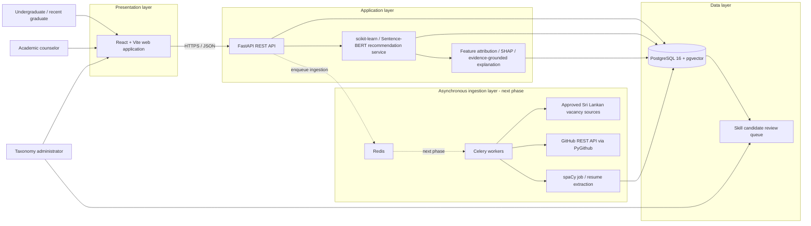

# Phase 1 — Architecture

## Technology decisions

| Concern | Planned technology | Phase 1 status |
| --- | --- | --- |
| HTTP API | FastAPI | Chosen; API implementation is later work |
| Web client | React + Vite | Chosen; UI implementation is later work |
| Relational store | PostgreSQL 16 | Schema and local container provided |
| Vector search | pgvector, 384-d vectors, HNSW cosine indexes | Columns and indexes provided |
| Background jobs | Celery + Redis | Planned for vacancy ingestion in the next phase |
| Vacancy/resume text extraction | spaCy | Planned; no parser included in Phase 1 |
| GitHub evidence | PyGithub REST client | Planned; no repository access included in Phase 1 |
| Recommendation models | scikit-learn and Sentence-BERT | Planned; model selection and implementation are later work |
| Explainability | SHAP plus evidence-grounded explanations | Planned; no model output is produced in Phase 1 |

## Roadmap alignment and architecture v2

This architecture follows the updated v3 roadmap. Phase 1 concentrates on the
core data foundation and system boundaries only; the live ingestion, dynamic
role discovery, and XAI components are intentionally kept as later-phase
capabilities rather than implemented in this baseline.

The key Phase 1 design decisions are:

- Keep the data model explicit and reviewable before live crawling begins.
- Create the foundation for skill normalization, demand snapshots, and evidence
  provenance.
- Reserve the queue/worker, parser, GitHub extraction, and recommender services
  for later roadmap phases.
- Make the taxonomy and evidence schema suitable for future HITL review and
  automatic skill harvesting.

## Logical architecture

The dashed queue/worker path is a planned later-phase integration. Phase 1
provides its target database entities, not a crawler or queue service.

## Data flow

1. Approved vacancy sources are collected with source identifiers and
   timestamps by a later-phase worker.
2. Extracted technical terms are normalized through `skills` and
   `skill_aliases`; unrecognized terms are written to `skill_candidates` for
   human review.
3. Normalized vacancy evidence is stored in `job_skills`. A later refresh
   calculates local demand snapshots using eligible, non-expired jobs.
4. With candidate consent, extracted or self-reported skills and
   0–5 proficiency are stored with evidence source in `student_skills`.
5. A later recommendation service compares candidate and role evidence,
   applies the coverage gate and deterministic tie-breaks, then returns
   explanations based on stored evidence.
6. The presentation layer renders roles, skill gaps, uncertainty, source
   freshness, and eligible local vacancies.

## Trust boundaries and privacy

- The browser is an untrusted client; the API must validate inputs and
  authorize profile access.
- Vacancy sites and GitHub are external sources. Collection must respect source
  terms, rate limits, and data provenance.
- Candidate resumes and GitHub usernames are personal data. Obtain consent,
  minimize retained data, restrict access, and define retention/deletion before
  enabling extraction.
- The Phase 1 schema stores an opaque resume storage key, not file contents.
  Storage provider and encryption-at-rest choices remain open.
- Database and API credentials belong in local environment configuration or a
  managed secret store, never in source control.

## Design constraints

- 384-dimensional vectors follow the supplied project documents. The chosen
  embedding model must generate the same dimension and be versioned with each
  embedding before production use.
- HNSW indexes use cosine distance. They do not replace keyword/relational
  filtering or offline ranking evaluation.
- Market demand uses `D_s = Count(s) / N_total`; both counts and refresh time
  are persisted so a UI can communicate evidence size and freshness.
- Recommendation and job-match outputs should retain the taxonomy, data, and
  model versions used to generate them when those services are implemented.
